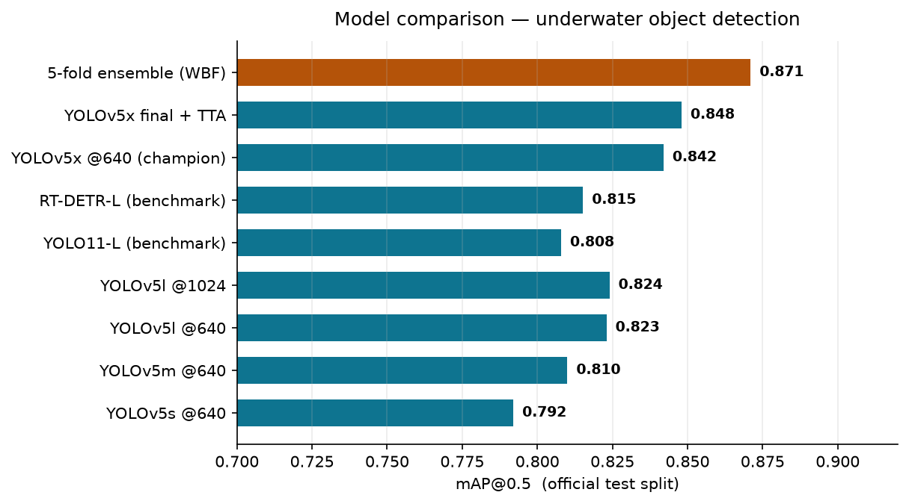
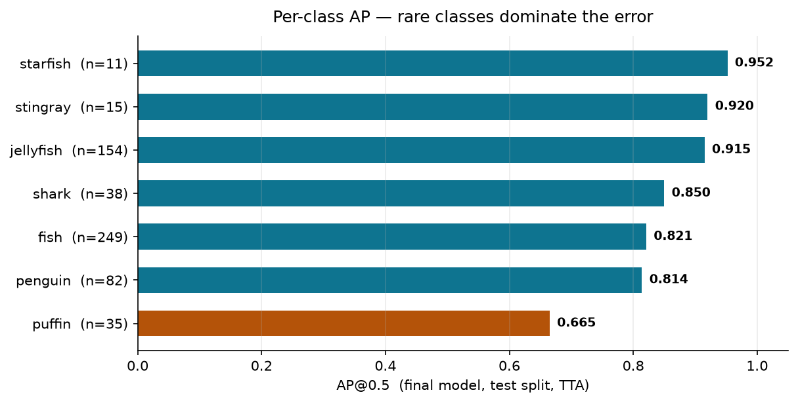
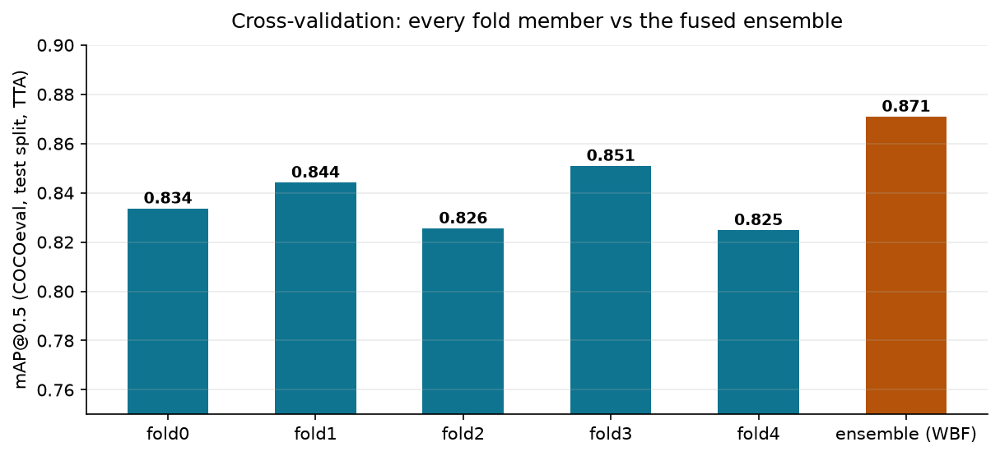
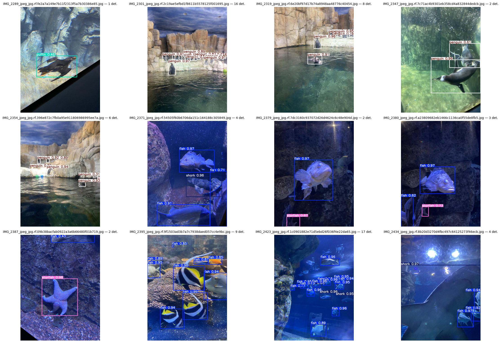
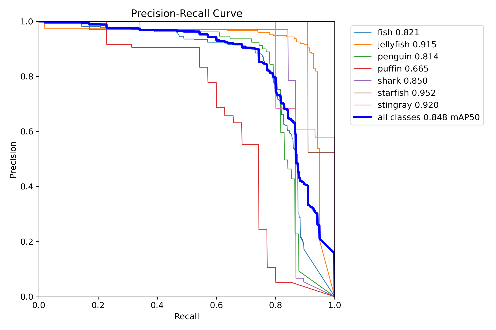
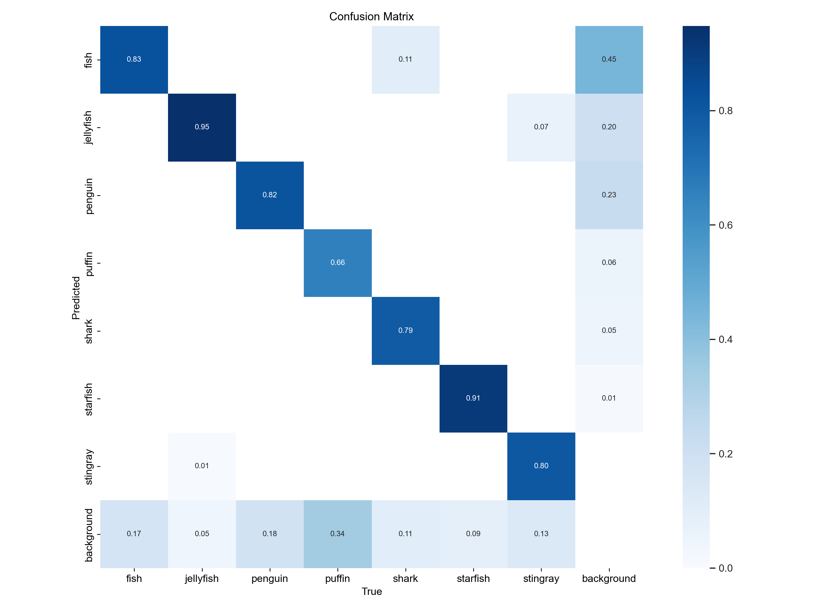
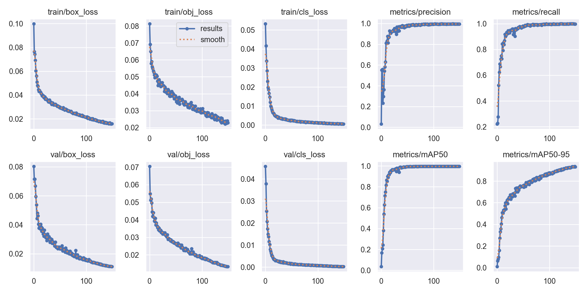
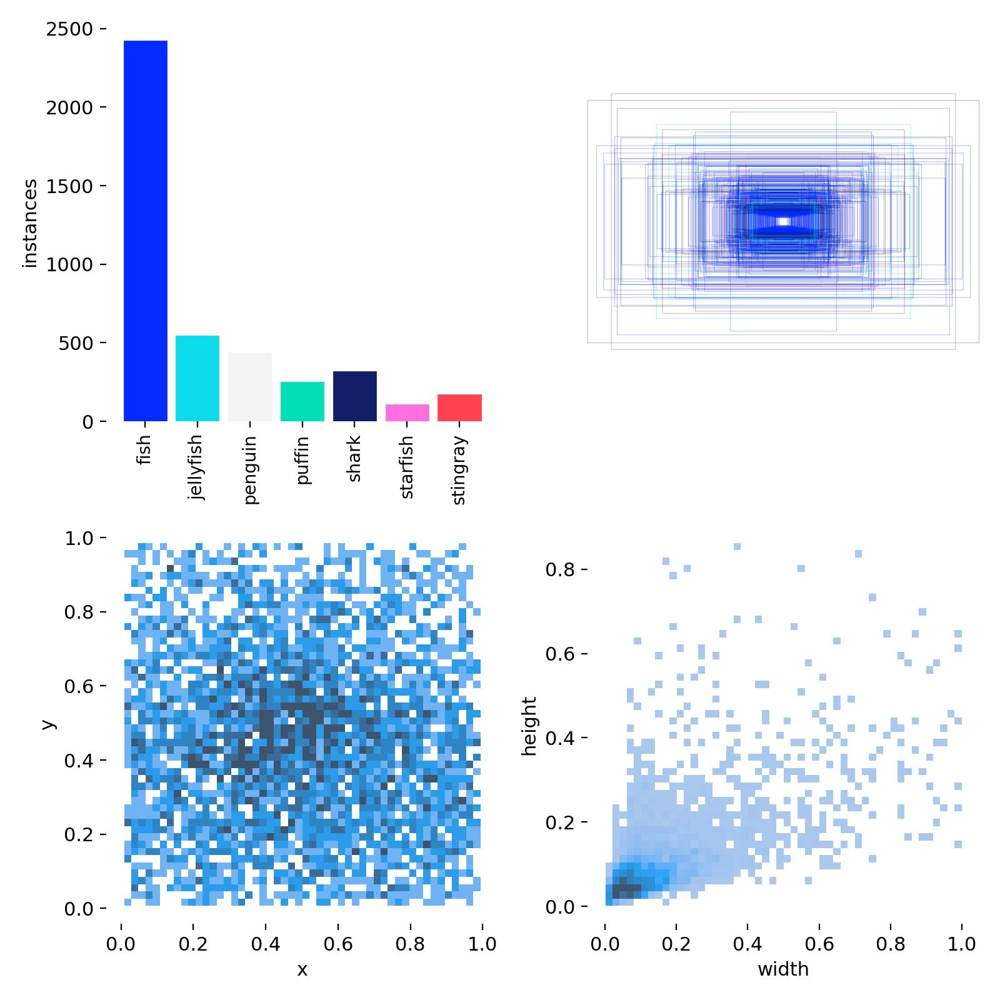

# Underwater Object Detection Using Deep Learning

YOLOv5-based detection of underwater animals (fish, jellyfish, penguin, puffin, shark, starfish, stingray) on the [aquarium-data-cots](https://www.kaggle.com/datasets/slavkoprytula/aquarium-data-cots) dataset - with a scale sweep, a 5-fold cross-validation ensemble, and YOLO11-L / RT-DETR-L benchmarks.

## About This Repository
This repository contains the expanded codebase for a Master's Deep Learning course project originally completed in September 2024. I recently upgraded the original single-model pipeline to demonstrate rigorous machine learning experimentation practices for academic research. This updated repository now features structured hyperparameter sweeps, 5-fold cross-validation ensembling (Weighted Boxes Fusion), and comparative benchmarking against modern architectures (YOLO11 and RT-DETR) under strict computational budgets. It is maintained here as a demonstration of reproducible research methodology and experimental design.

## Results (official test split - held out from all training and model selection)

| Model                                 | mAP@0.5   | mAP@0.5:0.95 |
| ------------------------------------- | --------- | ------------ |
| YOLOv5s @640 (baseline)               | 0.792     | 0.498        |
| YOLOv5x @640 - sweep champion         | 0.842     | 0.551        |
| YOLOv5x retrained on train+val, + TTA | 0.848     | 0.549        |
| **5-fold CV ensemble (WBF) + TTA**    | **0.871** | **0.566**    |
| YOLO11-L benchmark                    | 0.808     | 0.491        |
| RT-DETR-L benchmark                   | 0.815     | 0.510        |

YOLOv5 beats both modern architectures at the same training budget (+2.7 to +3.4 mAP@0.5), and the cross-validation ensemble adds +1.5 to +4.6 points over its own members. Per class, jellyfish / starfish / stingray score 0.92–0.95; puffin (0.665, 35 test instances) is the weak spot - a data-volume limitation rather than a modeling one.







## Detection samples (held-out test split, final model + TTA)



**Precision–recall** (official test split, TTA; per-class AP in the legend - puffin's low-recall segment is the red curve):



**Confusion matrix** (official test split, TTA): cross-class confusion is negligible - almost all errors are misses (background column), concentrated on puffin (34% missed):



**Training curves** (losses and mAP over the 150 epochs):



## Dataset

638 underwater images (two US aquariums), **4,817** bounding-box instances, **7 classes**, pre-split **train 448 / val 127 / test 63** in YOLO format. The official test split is used exactly once, for the final numbers.



## Pipeline

| Stage | Script                                                                        | What it does                                                                                                                                       |
| ----- | ----------------------------------------------------------------------------- | -------------------------------------------------------------------------------------------------------------------------------------------------- |
| 1     | `experiments/01_data_audit.py`                                                | Environment probe (GPU, internet, yolov5 pin) + full dataset audit → training-ready `data_fixed.yaml`                                              |
| 2     | `experiments/02_train_baseline_yolov5s.py`                                    | YOLOv5s @640, 100 epochs - end-to-end baseline                                                                                                     |
| 3     | `experiments/03_train_sweep_config.py`                                        | One run per model/size configuration → champion selection (yolov5m/l/x @640, yolov5l @1024)                                                        |
| 4     | `experiments/04_train_cv_fold.py`                                             | Deterministic stratified 5-fold CV of the champion; each fold predicts the official test split with TTA (`test_preds.json`)                        |
| 5     | `experiments/05_wbf_ensemble_eval.py`                                         | Builds test-split COCO ground truth, fuses the 5 folds' predictions with Weighted Boxes Fusion, scores members + ensemble with COCOeval (CPU-only) |
| 6     | `experiments/06_train_final_model.py`                                         | Champion retrained on train+val (575 images) → `best.pt` for inference; evaluated with and without TTA                                             |
| 7     | `experiments/07_benchmark_yolo11l.py`, `experiments/08_benchmark_rtdetr_l.py` | Ultralytics comparison runs (same data, same budget, ±TTA)                                                                                         |
| -     | `notebooks/09_demo_inference.ipynb`                                           | Loads the final model, renders a detection grid, prints official metrics                                                                           |

Shared helpers (fold building, dataset-path relocation, metrics parsing) live in `src/utils.py`. On Kaggle they ship as a small dataset and are auto-loaded by each script's `load_src_library()` block; locally they are imported from `src/`.

## Repository structure

```
├── README.md
├── assets/                       # charts + result images used in this README
│   ├── model_comparison.png
│   ├── per_class_ap.png
│   ├── cv_ensemble.png
│   ├── detection_grid.png
│   ├── pr_curve.png
│   ├── confusion_matrix.png
│   ├── training_curves.png
│   └── dataset_labels.jpg
├── src/
│   └── utils.py                  # shared helpers (folds, path relocation, parsers)
├── experiments/                  # stage scripts (run on Kaggle GPU kernels)
│   ├── 01_data_audit.py
│   ├── 02_train_baseline_yolov5s.py
│   ├── 03_train_sweep_config.py
│   ├── 04_train_cv_fold.py
│   ├── 05_wbf_ensemble_eval.py
│   ├── 06_train_final_model.py
│   ├── 07_benchmark_yolo11l.py
│   └── 08_benchmark_rtdetr_l.py
└── notebooks/
    └── 09_demo_inference.ipynb   # inference / visualization demo
```

## Running the experiments

The scripts are written for **Kaggle notebook/script kernels** (free T4/P100 GPUs):

1. Create a kernel per stage script; enable **GPU** and **Internet**.
2. Attach the dataset `slavkoprytula/aquarium-data-cots` (stages 4–5 also need the test-split labels; stage kernels re-locate dataset paths automatically, so any mount layout works).
3. Ship `src/utils.py` as a small private dataset (or paste it into the kernel) - the scripts' `load_src_library()` block picks it up.
4. Run stages in order; later stages consume earlier outputs (`data_fixed.yaml`, `test_preds.json`, `best.pt`) via `kernel_sources`.
5. Notes: Stages 2–4, 6–7 need GPU, stage 5 is CPU-only. A full reproduction costs roughly 15–20 GPU-hours

Each script prints per-class precision / recall / mAP tables and writes its metrics JSON plus model weights to `/kaggle/working`.

## Metrics

- **IoU** - box overlap between prediction and ground truth; a prediction counts only above a threshold.
- **AP@0.5** - area under the precision–recall curve for one class at IoU 0.5.
- **mAP@0.5** - mean AP over the 7 classes; **mAP@0.5:0.95** averages over IoU 0.5→0.95 (stricter localization; COCO's primary metric).
- **Precision / Recall / F1** are reported at each model's F1-optimal confidence threshold (final model + TTA: P 0.892, R 0.792, F1 ≈ 0.839). "Accuracy" is not meaningful for detection (the background dominates); mAP summarizes the whole precision–recall trade-off instead.

## Requirements

- Python 3.10+
- PyTorch (CUDA for training), PyYAML, Pillow - preinstalled on Kaggle
- `ultralytics` 8.4.x (benchmarks only; installed in-script)
- `ensemble-boxes`, `pycocotools` (stage 5; installed in-script)
- YOLOv5 is cloned in-script from [ultralytics/yolov5](https://github.com/ultralytics/yolov5)

## Acknowledgments

- Dataset: [slavkoprytula/aquarium-data-cots](https://www.kaggle.com/datasets/slavkoprytula/aquarium-data-cots)
  (Roboflow-sourced aquarium imagery)
- [YOLOv5](https://github.com/ultralytics/yolov5) and
  [Ultralytics](https://github.com/ultralytics/ultralytics) (YOLO11 / RT-DETR)
- [ensemble-boxes](https://github.com/ita9niiwork/ensemble-boxes) (WBF fusion),
  [pycocotools](https://github.com/ppwwyyxx/cocoapi) (COCO evaluation)
